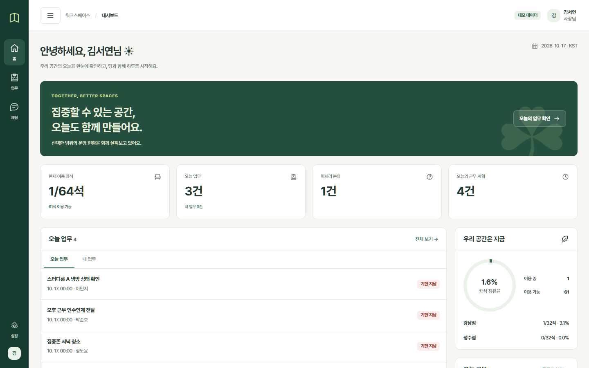
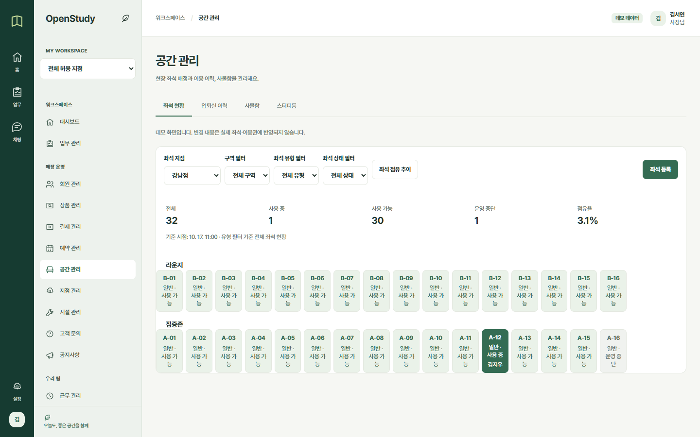
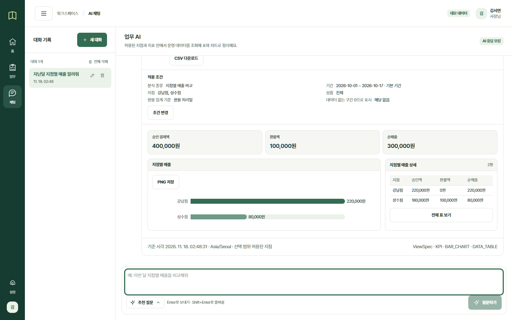
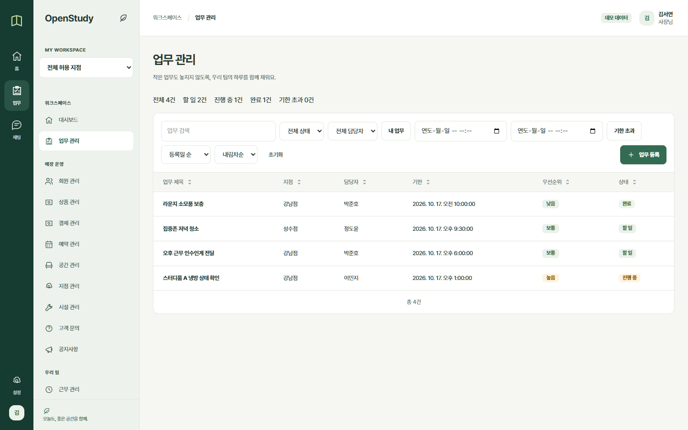
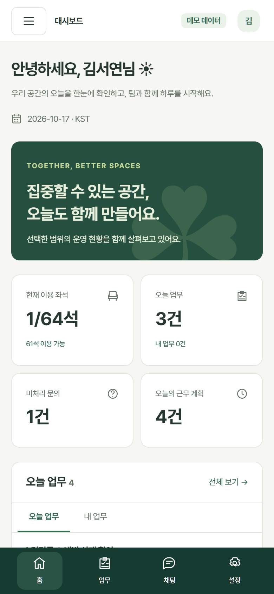
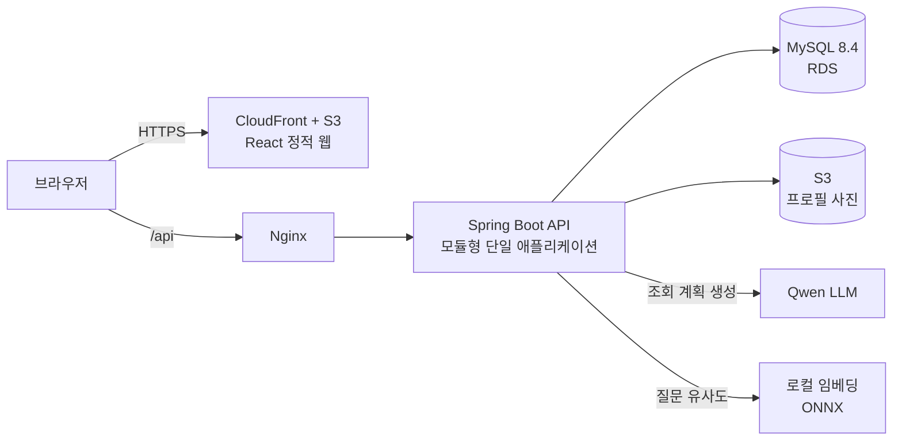

# OpenStudy

**스터디카페 지점 운영을 하나로 묶은 팀 운영 워크스페이스**

사장님·지점 관리자·직원이 한 서비스에서 지점 현황을 확인하고, 고객·이용권·결제, 좌석·스터디룸·사물함, 업무·채팅, 근무·근태, 매출을 관리합니다. 자연어로 질문하면 운영 데이터를 조회해 표와 차트로 보여 주는 AI 분석도 제공합니다.




## 왜 만들었나

스터디카페 운영 업무는 결제 단말, 좌석 관리 프로그램, 메신저, 근무표 엑셀처럼 여러 도구에 흩어져 있습니다. 지점이 늘수록 "오늘 누가 무엇을 해야 하는지", "지난달 지점별 매출이 어땠는지"를 확인하는 데 시간이 듭니다.

OpenStudy는 이 업무를 하나의 백오피스로 모으고, 역할과 지점에 따라 볼 수 있는 범위를 나눕니다.

## 주요 기능

| 영역 | 기능 |
|---|---|
| 🏠 운영 홈 | 이용 좌석·오늘 업무·미처리 문의·근무 계획을 한 화면에서 확인 |
| ✅ 업무·협업 | 업무 등록·담당자·체크리스트, 채널·DM·스레드, 업무와 대화 연결 |
| 👥 고객·거래 | 회원·보유 이용권, 이용권 상품·요율, Mock 결제·환불, 이용 이력 |
| 💺 공간 | 좌석 배치도·입퇴실·이용권 차감, 스터디룸 예약 달력, 사물함 대여 |
| 🛠 운영 | 시설 점검, 고객 문의, 공지 |
| 🗓 인력 | 주간 근무표, 출퇴근·휴게, 근태 정정, 휴가·대체근무 |
| 📊 매출 | 지점별 매출(환불 처리일·원거래일 두 기준) |
| 🤖 AI 분석 | "지난달 지점별 매출 알려줘" 같은 질문 → 권한 범위 안에서 조회 → 표·차트 |
| 🔐 조직·권한 | 지점, 직원 메일 초대·관리자 승인, 사장님·지점 관리자·직원 역할과 권한 프리셋 |

## 화면

| 좌석 배치도 | AI 자연어 분석 |
|---|---|
|  |  |
| **업무 관리** | **모바일** |
|  |  |

<sub>데모 모드(가상 데이터)에서 캡처한 화면입니다.</sub>

## 기술 스택

| 구분 | 기술 |
|---|---|
| Backend | Java 21, Spring Boot 4.1, Spring Security, Spring Session JDBC, Spring Data JPA, Flyway, MySQL 8.4 |
| AI | Spring AI(Qwen, OpenAI 호환), ONNX Runtime 로컬 임베딩 |
| Frontend | React 19, TypeScript 5.9, Vite 8, TanStack Query, Zustand, Zod, Radix UI, MSW |
| Test | JUnit 5, Testcontainers, Vitest, Testing Library, Playwright |
| Infra | AWS(EC2, RDS, S3, CloudFront), Terraform, Nginx, Docker, GitHub Actions |

## 아키텍처



- **Backend**는 업무별 모듈(controller → service → repository → entity)로 나누고, 모듈 사이에는 공개한 service와 DTO만 사용합니다. 경계는 아키텍처 테스트로 검사합니다.
- **인증**은 HttpOnly 쿠키 세션과 CSRF 토큰을 사용하고, 서버가 매 요청 역할·지점 범위를 확인합니다.
- **AI 분석**은 LLM이 SQL을 직접 만들지 않습니다. LLM은 조회 계획만 만들고, 서버가 이를 검증된 쿼리와 화면 명세로 바꾼 뒤 요청자의 권한으로 실행합니다. 같은 의미의 질문은 저장된 계획을 재사용해 LLM 호출을 줄입니다.
- AWS 배치도는 [OpenStudy-Infra 아키텍처 문서](https://github.com/OpenStudyService/OpenStudy-Infra/blob/main/docs/architecture.md)에 있습니다.

## 설계에서 신경 쓴 점

- **중복·경합에 안전한 거래**: 결제·환불·예약·입퇴실은 멱등 키로 같은 요청이 두 번 처리되지 않게 하고, 수정은 버전 충돌을 감지해 입력을 잃지 않고 다시 저장할 수 있게 했습니다.
- **명시적 화면 갱신**: 실시간 푸시 대신 메뉴 진입·새로고침·조건 변경 때 다시 조회해 화면과 서버 상태의 기준을 단순하게 유지했습니다.
- **실제 DB로 검증**: 백엔드 통합 테스트는 Testcontainers MySQL에서, 프론트엔드 주요 흐름은 실제 Backend·MySQL에 연결한 Playwright 시나리오로 검증했습니다.
- **데모와 실서버 분리**: 백엔드 없이 체험할 수 있는 데모 빌드와 실제 API 빌드를 나누고, 실서버 빌드에 데모 코드가 섞이지 않는지 산출물을 검사합니다.

## 저장소 구성

| 저장소 | 내용 |
|---|---|
| [OpenStudy-Frontend](https://github.com/OpenStudyService/OpenStudy-Frontend) | React 백오피스 화면, 데모 모드, Playwright 검증 |
| [OpenStudy-Backend](https://github.com/OpenStudyService/OpenStudy-Backend) | Spring Boot API, DB 마이그레이션, AI 분석 |
| [OpenStudy-Infra](https://github.com/OpenStudyService/OpenStudy-Infra) | AWS 네트워크·EC2·RDS·정적 웹 배포 Terraform |

## 빠르게 체험하기

백엔드 없이 데모 모드로 실행할 수 있습니다. (Node.js 24)

```sh
git clone https://github.com/OpenStudyService/OpenStudy-Frontend.git
cd OpenStudy-Frontend
npm ci
npm run dev
```

로그인 화면에서 **사장님으로 체험**을 누르면 강남점·성수점 가상 데이터로 시작합니다. 실제 서버 연결 방법은 각 저장소 README를 참고하세요.

## 개발 과정

1. 요구사항 명세(SRS) 작성 → 61개 요구사항과 운영 정책 확정
2. HTML 목업으로 화면 구조와 사용자 흐름 검증
3. 요구사항을 마일스톤 M1~M15로 나누어 GitHub 이슈·PR 단위로 구현
4. 기능마다 단위 테스트, 마일스톤마다 통합·실서버 검증
5. 주요 결정과 검증 결과를 각 저장소 `docs/development-log/`에 날짜별로 기록

### 현황

- 핵심 업무(M1~M10)와 확장 기능(M12~M15)을 구현했습니다.
- 남은 작업은 **M11 릴리스 검증·운영 준비**(전체 회귀, 백업·복구, 모니터링, 운영 보안 점검)와 AI 화면의 실제 API 연결입니다.

### 프로젝트 변경 이력

이 저장소는 처음에 공유 오피스 관리 플랫폼(OpenOffice)으로 기획했습니다. 이후 스터디카페 지점 운영 백오피스로 범위를 좁혀 OpenStudy로 개발했습니다.

## 팀

| 이름 | GitHub | 참여 |
|---|---|---|
| 최승준 | [@coffee2think](https://github.com/coffee2think) | 기획, Backend, Frontend |
| 박용현 | [@SteelCrab](https://github.com/SteelCrab) | 기획, Infra |

## License

[MIT](LICENSE)
